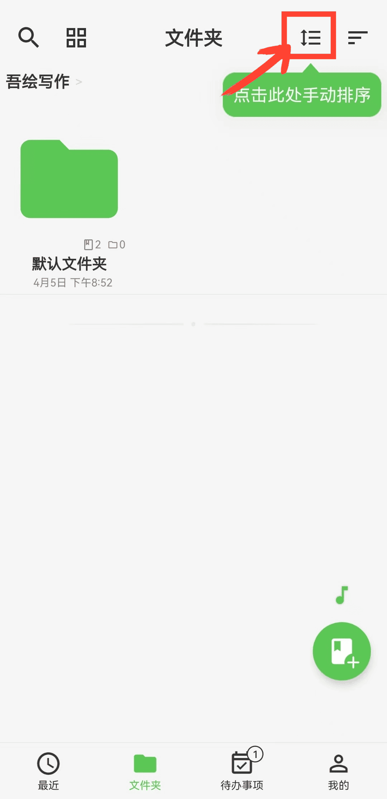

[Benutzerhandbuch](/yeswriter/manual/de) > [Ordnerverwaltung](/yeswriter/manual/de/folder) >

Ordner sortieren
---

Gehen Sie zur Seite „Ordner“, tippen Sie auf „Sortieren nach“ und wählen Sie die gewünschte Sortiermethode.

#### Manuell sortieren

Nachdem Sie „Manuell sortieren“ ausgewählt haben, tippen Sie erneut auf „Manuell sortieren“ und ziehen Sie die Ordner, um ihre Reihenfolge anzupassen.

