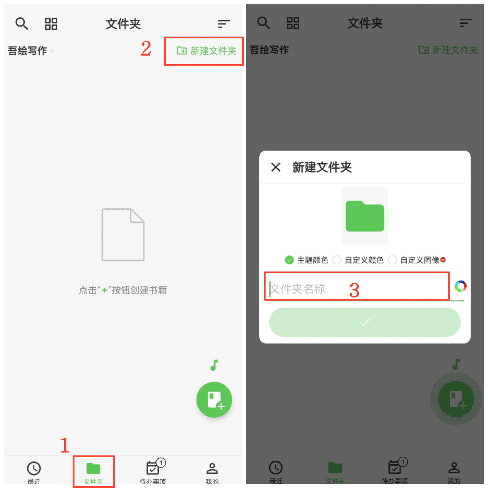

[Benutzerhandbuch](/yeswriter/manual/de) > [Inhalte erstellen](/yeswriter/manual/de/new) >

Ordner erstellen
---
#### Schritte

1. Gehen Sie zur Seite „Ordner“.
2. Tippen Sie auf „Neuer Ordner“.
3. Geben Sie den Ordnernamen ein.

#### Hinweise

1. Tippen Sie auf „Benutzerdefiniertes Bild“, um ein Bild aus Ihrem Album als Ordnercover auszuwählen.

2. Tippen Sie auf die farbige runde Schaltfläche rechts neben dem Ordnernamen, um die Namensfarbe festzulegen.
