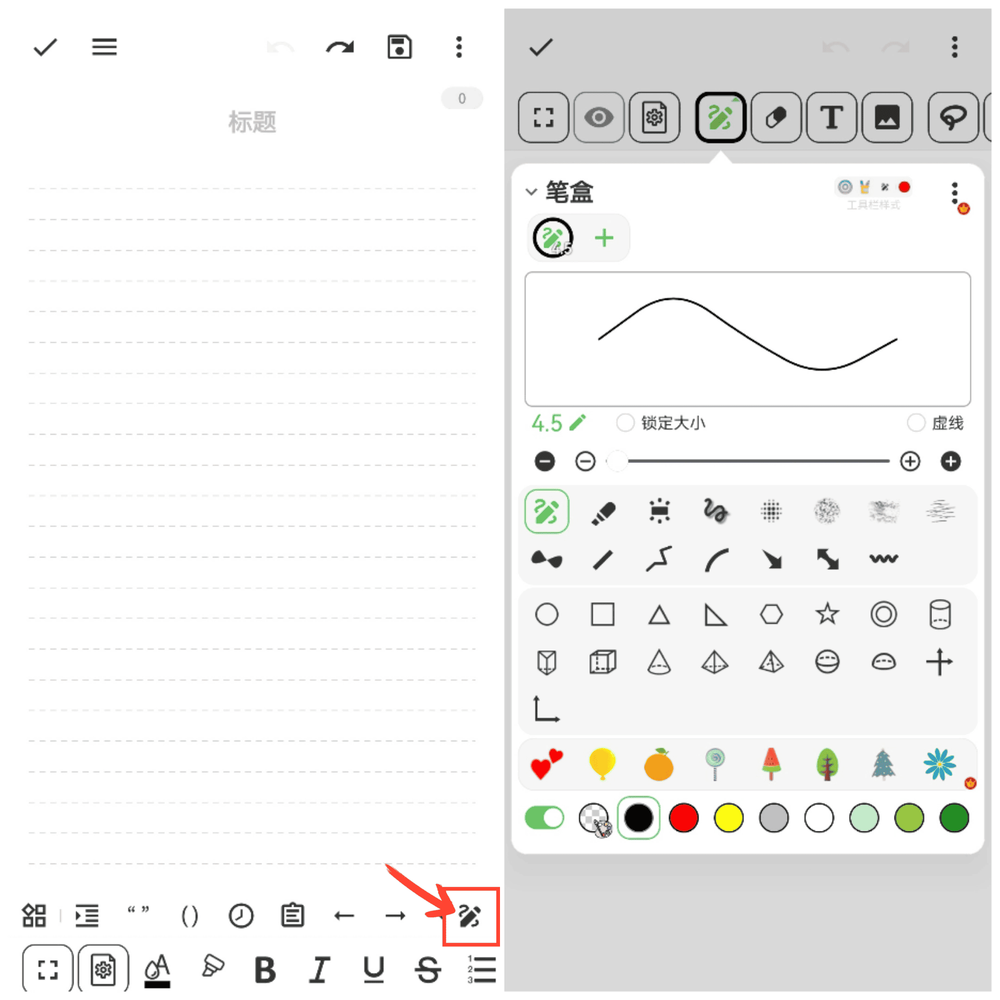

[Benutzerhandbuch](/yeswriter/manual/de) > [Textbearbeitung](/yeswriter/manual/de/notes_page) >

Pinsel verwenden
---

Tippen Sie auf „Pinsel“, um den Canvas-Editor zu öffnen. Dort können Sie Linien, Emojis, Text, Bilder und andere Elemente einfügen.

