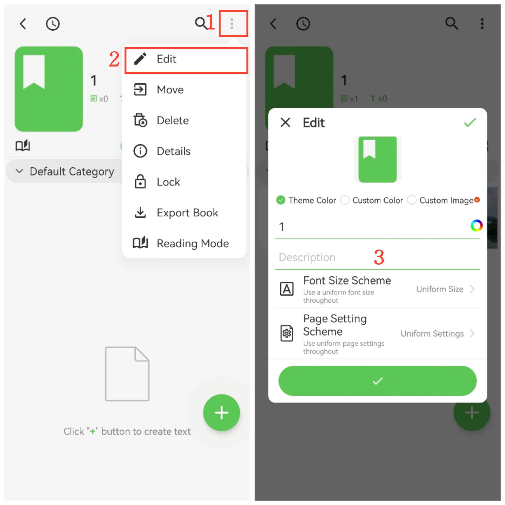

[User Manual](/yeswriter/manual/en) > [Book Management](/yeswriter/manual/en/book_page) >

Change Book Cover and Font
---
#### Steps

1. Tap More in the upper-right corner.

2. Tap Edit to open the book editing page.

#### Tips

1. Tap Custom Image to choose an image from your album as the book cover.

2. Tap the colored round button on the right side of the book title to set the title color.

3. Tap Description to add an introduction for the book.

4. Tap Font Size Scheme to use a unified global font size or customize local font sizes.

5. Tap Page Scheme to use a unified global background or customize an individual background.
