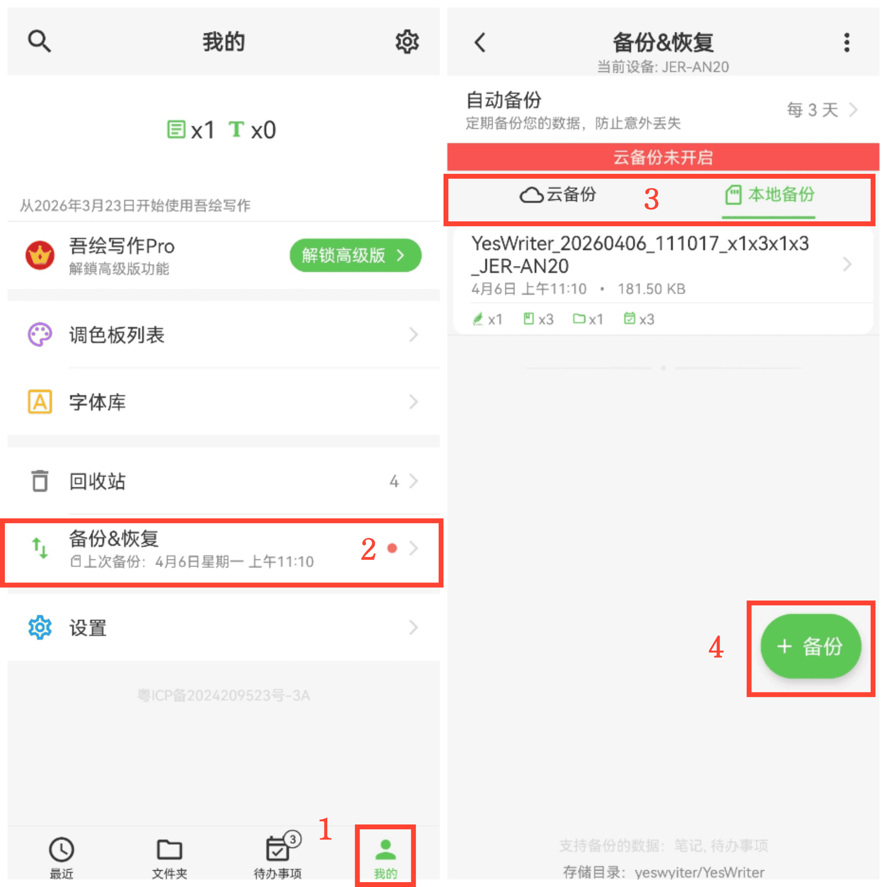

[User Manual](/yeswriter/manual/en) > [Backup and Restore](/yeswriter/manual/en/data_backup_and_recovery) >

Back Up Data
---
#### Steps

1. Go to the Me page.

2. Tap Backup & Restore.

3. Select Local Backup or Cloud Backup.

4. Tap + Backup to start backing up.

#### Tips

First backup: choose a backup location before running the backup.
