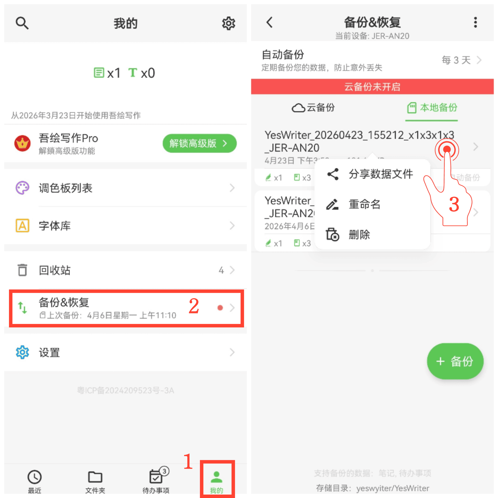

[User Manual](/yeswriter/manual/en) > [Backup and Restore](/yeswriter/manual/en/data_backup_and_recovery) >

Manage Backup Files
---
#### Steps

1. Go to the Me page.

2. Tap Backup & Restore.

3. Long-press a backup file to share, rename, or delete the backup data.

