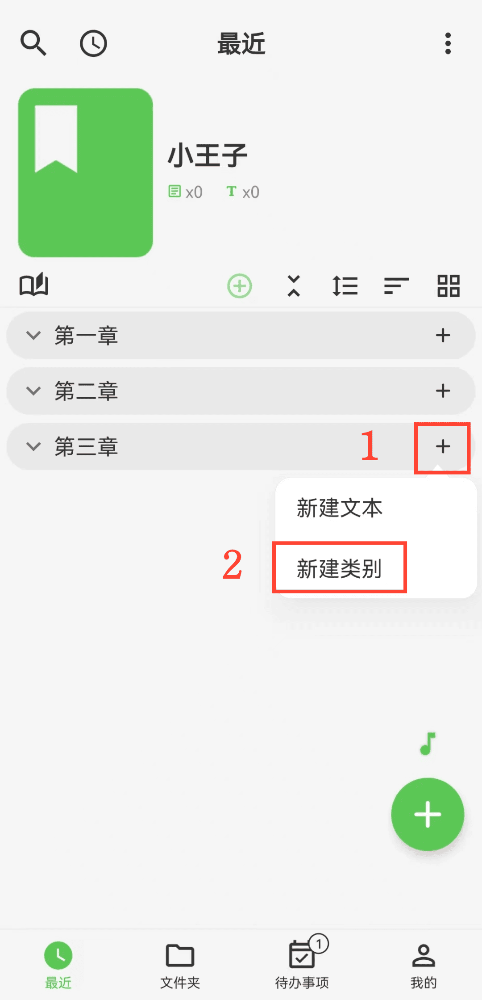

[User Manual](/yeswriter/manual/en) > [Create Content](/yeswriter/manual/en/new) >

Add Category
---
#### Steps

1. On the book page, tap the + button on the right side of the target category.

2. Select New Category.

#### Tips

The new category will be inserted after the selected item.

For example, to add a chapter after Chapter 2, tap the + button on the right side of Chapter 2.
