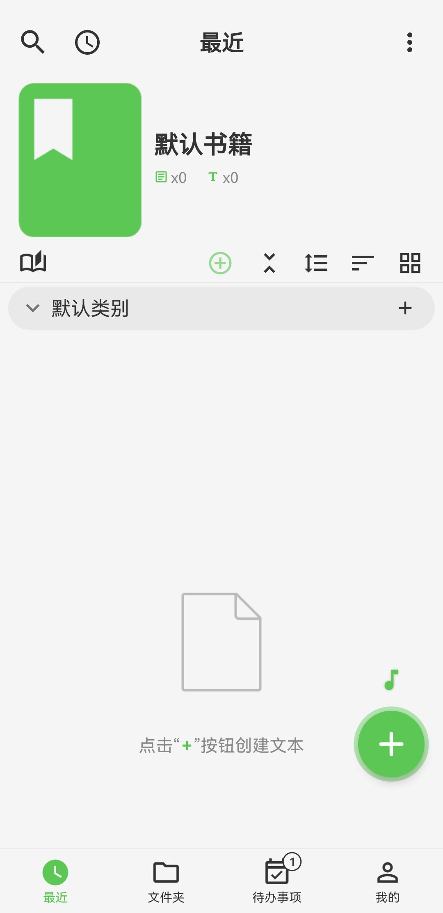
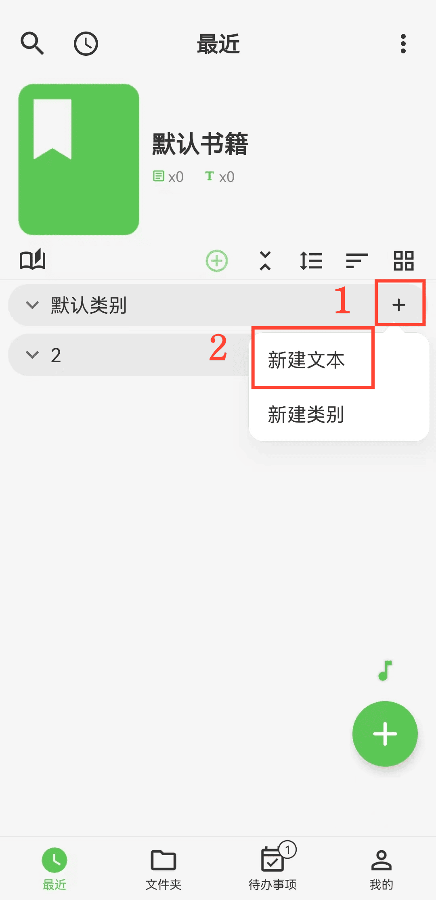

[User Manual](/yeswriter/manual/en) > [Create Content](/yeswriter/manual/en/new) >

Create Text
---
#### Steps

Go to the Recent page and tap the green + button in the lower-right corner to create a text.

#### Tips

Texts created on the Recent page are added to the Category at the bottom of the list by default. To add a text to a specific category, tap the + button on the right side of that category.

