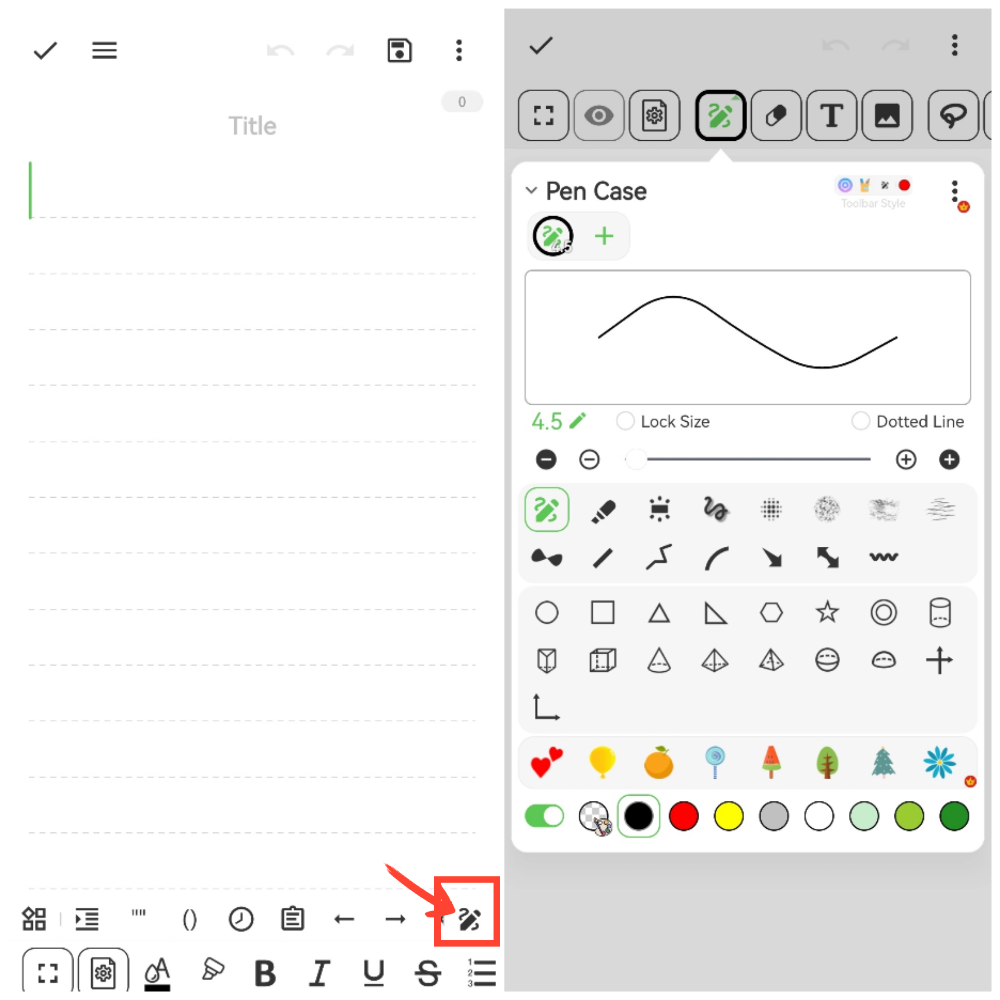

[User Manual](/yeswriter/manual/en) > [Text Editing](/yeswriter/manual/en/notes_page) >

Use Brush
---

Tap Brush to enter the canvas editor, where you can insert lines, emojis, text, images, and other elements.

