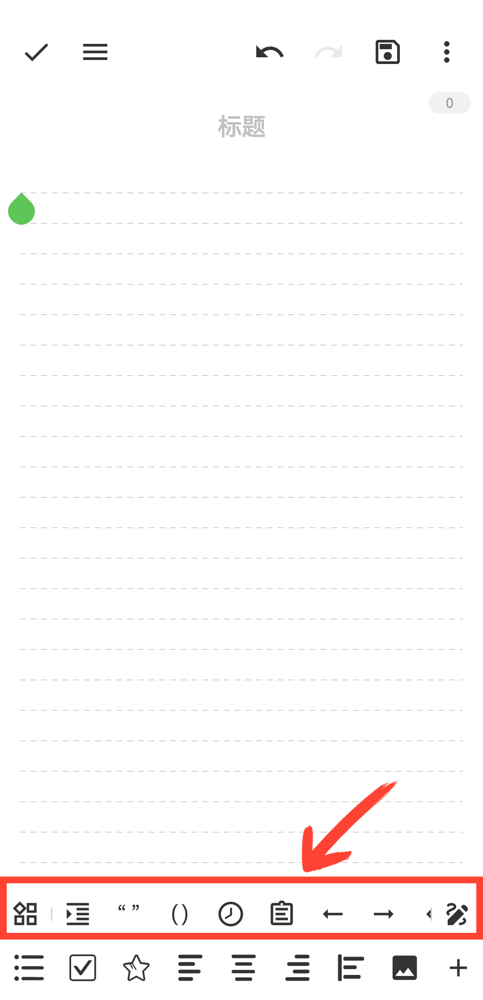

[User Manual](/yeswriter/manual/en) > [Text Editing](/yeswriter/manual/en/notes_page) >

Use Quick Toolbar
---
In the quick toolbar, you can quickly insert parentheses, quotation marks, timestamps, or open the clipboard.

#### Tips

1. Tap Quick Input to quickly adjust paragraph formatting.

2. Tap the ⋮ button in the upper-right corner to show or hide the quick toolbar.

