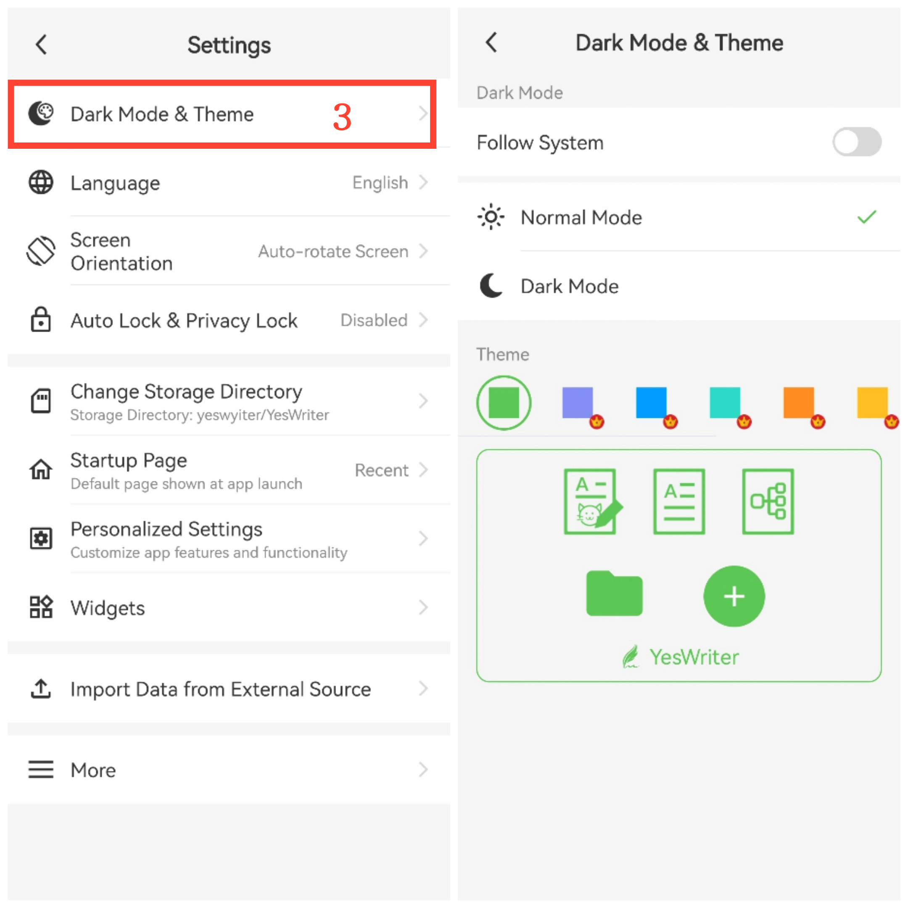

[User Manual](/yeswriter/manual/en) > [Settings](/yeswriter/manual/en/settings) >

Switch Dark Mode and Theme Color
---
Dark mode provides a more comfortable reading experience and helps reduce eye strain. This feature lets you switch to dark mode and choose a theme color based on your preference.

### Steps
1. On the main screen, tap Me.
2. Go to Settings.
3. Tap Dark Mode & Theme.
4. Here you can switch dark mode and choose different theme colors to personalize the interface.

