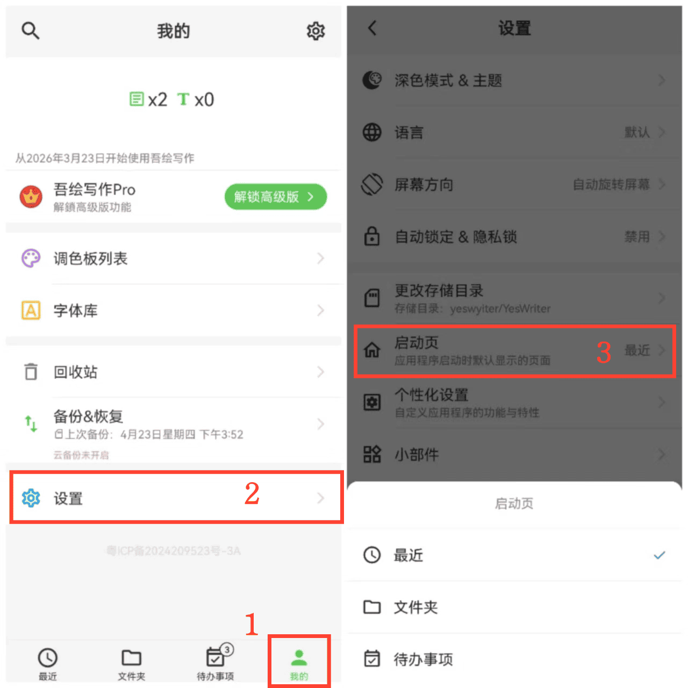

[User Manual](/yeswriter/manual/en) > [Settings](/yeswriter/manual/en/settings) >

Set Startup Page
---

### Steps
1. On the main screen, tap Me.
2. Go to Settings.
3. Tap Startup Page to set the page shown by default when entering the app.

