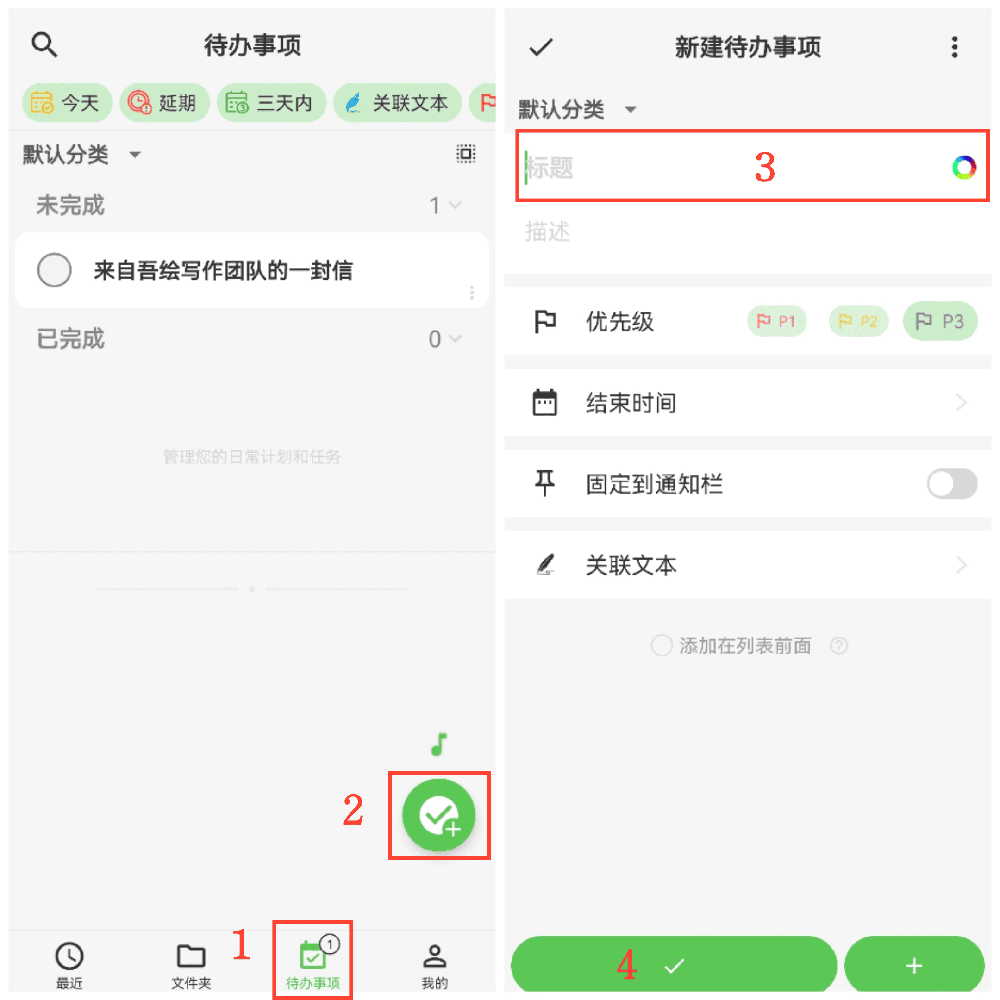

[Manual de usuario](/yeswriter/manual/es) > [Tareas](/yeswriter/manual/es/to_do) >

Crear tarea
---
#### Pasos

1. Ve a la página «Tareas».

2. Toca el botón «+» en la esquina inferior derecha.

3. Rellena el título, la descripción y otros datos.

4. Toca «Confirmar» para crearla.

#### Consejos

1. Añadir continuamente: en la página «Nueva tarea», toca «+» en la esquina inferior izquierda para seguir añadiendo sin salir de la página.

2. Recuento de elementos: la barra inferior muestra el número de tareas pendientes.

3. Fijar elemento: toca «Fijar» en la esquina superior derecha de un elemento de la lista para moverlo arriba.

