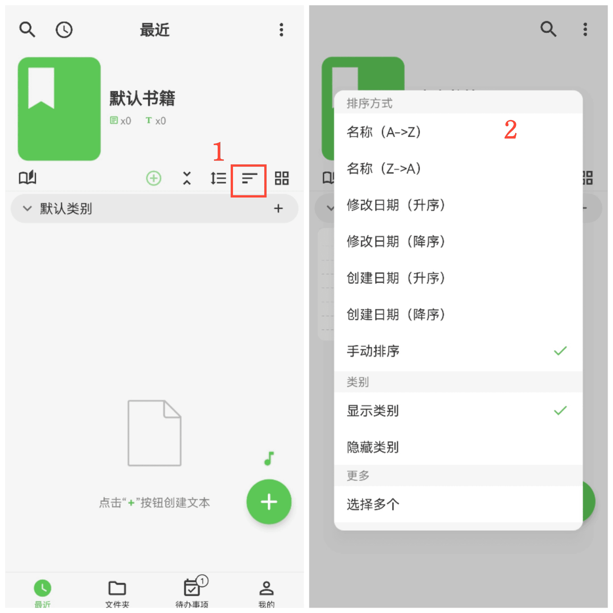

[Manuel utilisateur](/yeswriter/manual/fr) > [Gestion des livres](/yeswriter/manual/fr/book_page) >

Trier les textes et catégories
---
#### Étapes

Touchez « Trier par » et sélectionnez la méthode de tri souhaitée.

Tri manuel
---
#### Étapes

1. Après avoir sélectionné « Tri manuel », touchez le bouton « Tri manuel » situé à côté.

2. Choisissez le tri des textes ou le tri des catégories.

3. Appuyez longuement sur un élément et faites-le glisser vers le haut ou le bas pour ajuster l’ordre.

