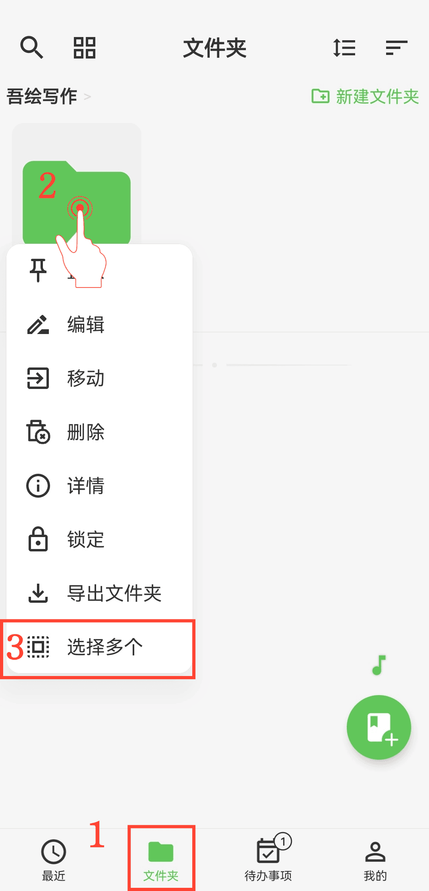

[Manuel utilisateur](/yeswriter/manual/fr) > [Gestion des dossiers](/yeswriter/manual/fr/folder) >

Gérer les dossiers en lot
---

#### Étapes

1. Accédez à la page « Dossiers ».

2. Appuyez longuement sur le dossier cible.

3. Touchez « Sélection multiple » dans le menu contextuel.

4. Sélectionnez les dossiers souhaités, puis déplacez-les, supprimez-les ou exportez-les en lot.

