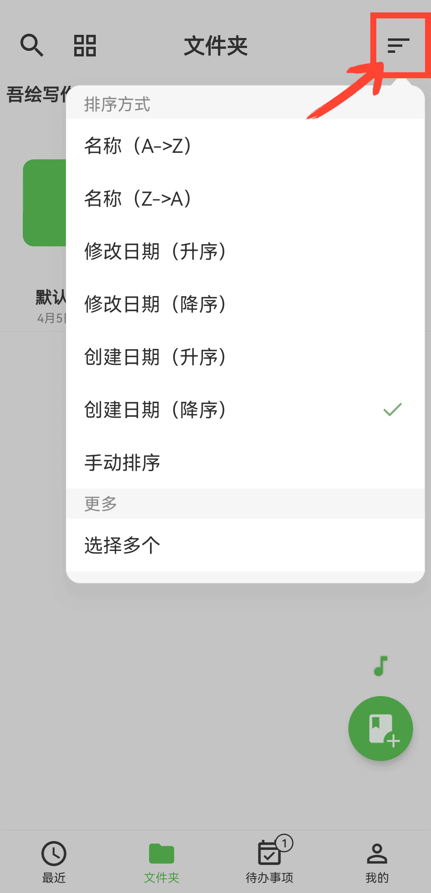

[Manuel utilisateur](/yeswriter/manual/fr) > [Gestion des dossiers](/yeswriter/manual/fr/folder) >

Trier les dossiers
---

Accédez à la page « Dossiers », touchez « Trier par » et sélectionnez la méthode de tri souhaitée.

#### Tri manuel

Après avoir sélectionné « Tri manuel », touchez à nouveau « Tri manuel », puis faites glisser les dossiers pour ajuster leur ordre.

