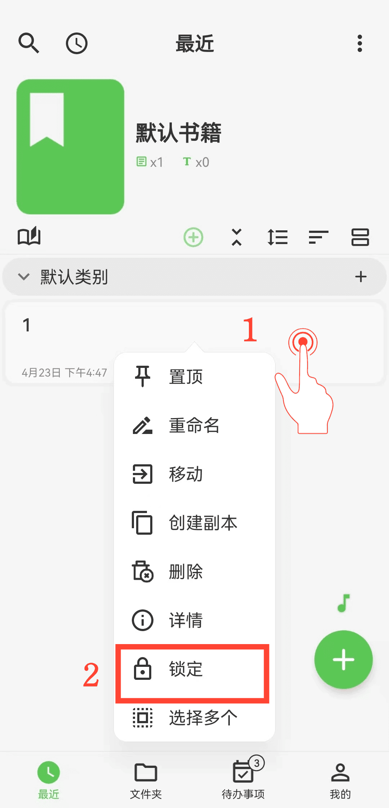

[Manuel utilisateur](/yeswriter/manual/fr) > [Paramètres](/yeswriter/manual/fr/settings) >

Utiliser le verrouillage privé
---
Avec le verrouillage privé, vous pouvez verrouiller certains textes, livres et dossiers.

#### Étapes

1. Appuyez longuement sur le texte, le livre ou le dossier à verrouiller ou déverrouiller.

2. Dans le menu contextuel, touchez « Verrouiller » ou « Déverrouiller » pour terminer l’action.

#### Conseils

- Dans « Moi » > « Verrouillage automatique et verrouillage privé », vous pouvez définir le déverrouillage par empreinte ou par mot de passe.

- Le verrouillage privé est un mécanisme de verrouillage temporaire local. Après avoir verrouillé et sauvegardé des textes, si vous les restaurez sur un autre appareil, vous pouvez les consulter sans les déverrouiller à nouveau.
