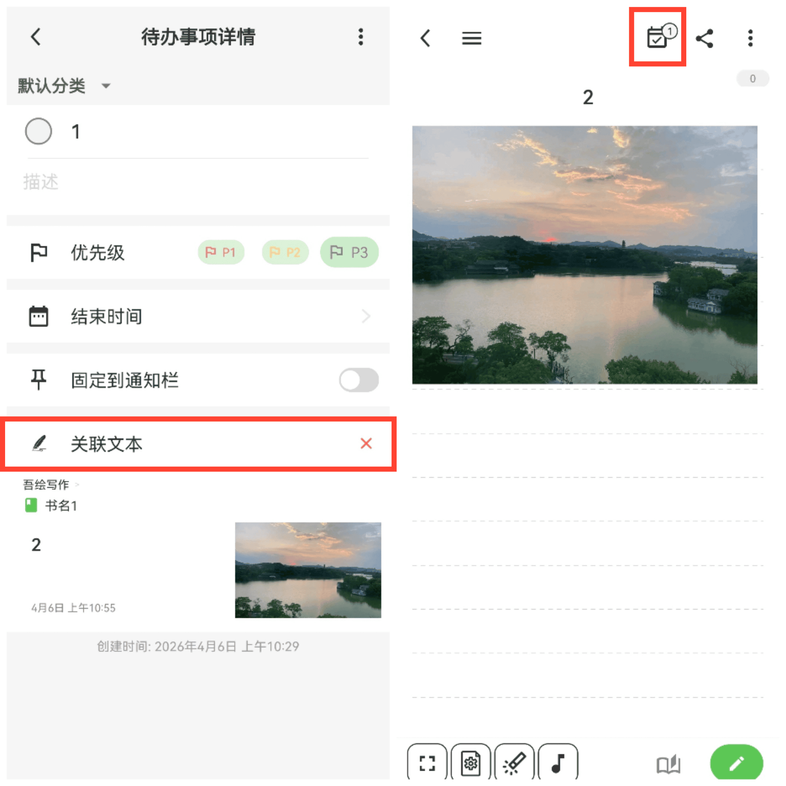

[Manuel utilisateur](/yeswriter/manual/fr) > [Tâches](/yeswriter/manual/fr/to_do) >

Associer un texte
---

Vous pouvez choisir un texte associé lors de la création d’une tâche.

Vous pouvez ainsi toucher une tâche pour accéder rapidement au texte associé.

Lors de la consultation du texte, vous pouvez aussi voir les marqueurs liés aux tâches, afin de vous rappeler de les terminer.

