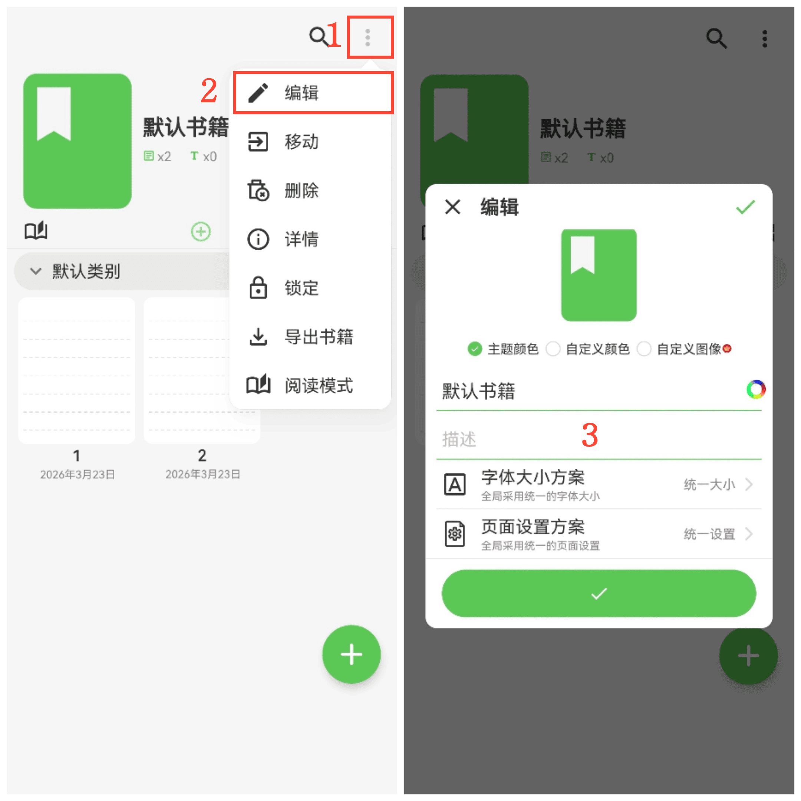

[Manuale utente](/yeswriter/manual/it) > [Gestione libri](/yeswriter/manual/it/book_page) >

Modificare copertina e carattere del libro
---
#### Passaggi

1. Tocca “Altro” nell’angolo in alto a destra.

2. Tocca “Modifica” per aprire la pagina di modifica del libro.

#### Suggerimenti

1. Tocca “Immagine personalizzata” per scegliere un’immagine dall’album come copertina del libro.

2. Tocca il pulsante rotondo colorato a destra del titolo del libro per impostarne il colore.

3. Tocca “Descrizione” per aggiungere una presentazione del libro.

4. Tocca “Schema dimensione carattere” per usare una dimensione globale uniforme o personalizzare le dimensioni locali.

5. Tocca “Schema pagina” per usare uno sfondo globale uniforme o personalizzare uno sfondo individuale.
