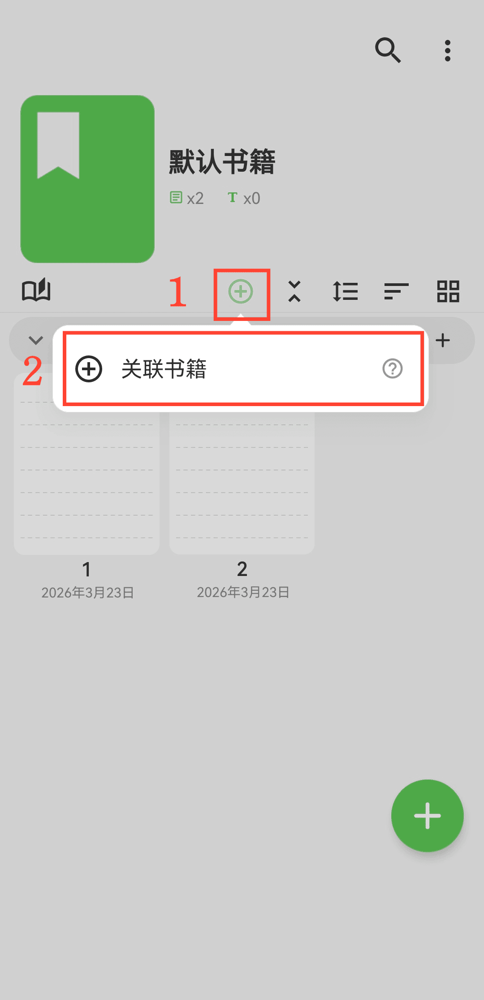

[Manuale utente](/yeswriter/manual/it) > [Gestione libri](/yeswriter/manual/it/book_page) >

Collegare libri di riferimento
---
#### Passaggi

1. Tocca il pulsante “⊕”.

2. Tocca “Collega libri”.

3. Seleziona i libri da collegare. Puoi collegare più libri.

#### Suggerimenti

I libri possono essere collegati tra loro. Quando scrivi un manoscritto principale, puoi collegare libri di riferimento per gestirli in modo centralizzato e consultarli rapidamente.
