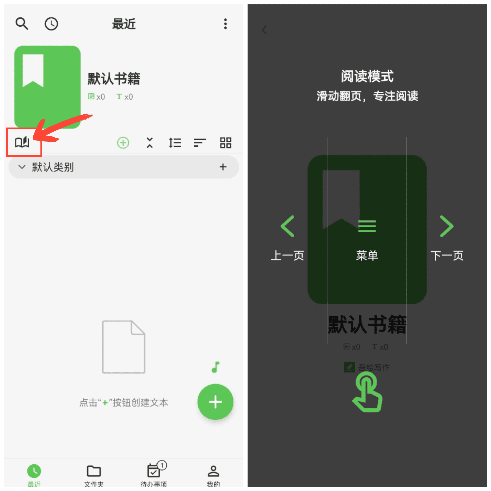

[Manuale utente](/yeswriter/manual/it) > [Gestione libri](/yeswriter/manual/it/book_page) >

Modalità lettura
---
#### Passaggi

1. Tocca “Modalità lettura”.

2. Scorri per voltare pagina e iniziare una lettura concentrata.

