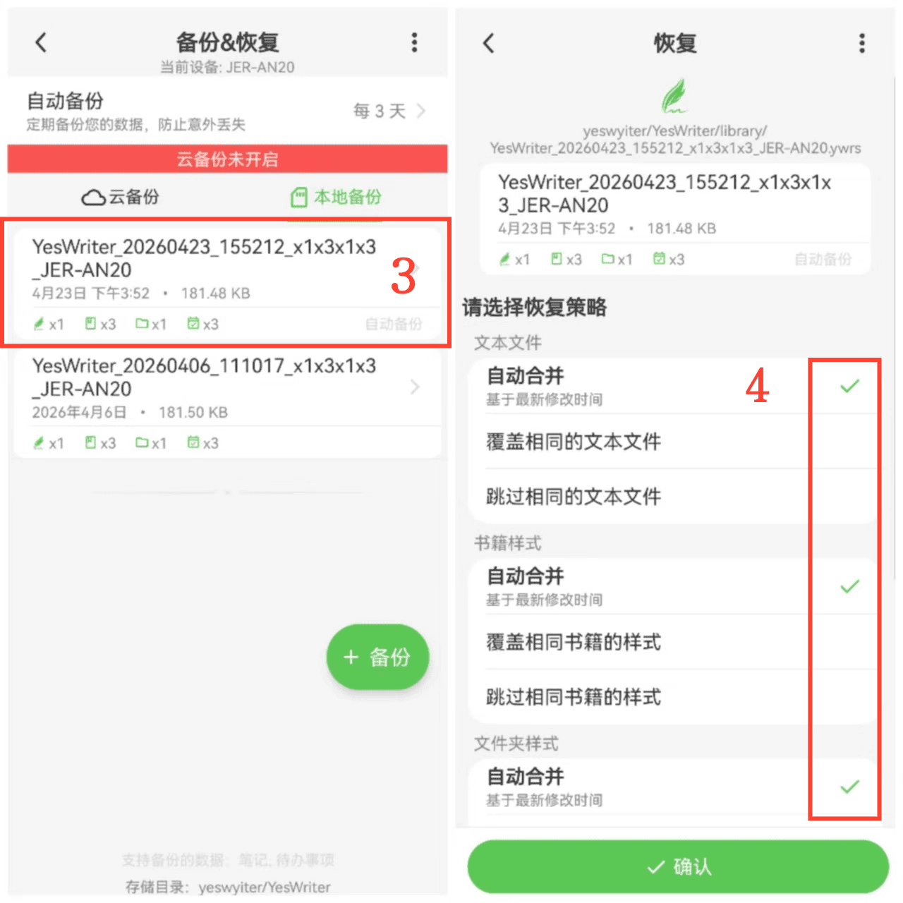

[Manuale utente](/yeswriter/manual/it) > [Backup e ripristino](/yeswriter/manual/it/data_backup_and_recovery) >

Ripristinare dati
---
#### Passaggi

1. Vai alla pagina “Io”.

2. Tocca “Backup e ripristino”.

3. Tocca un file di backup.

4. Seleziona le opzioni di ripristino desiderate.

5. Tocca “Conferma” per avviare il ripristino dei dati.

#### Suggerimenti

Durante il ripristino dei dati di backup sono disponibili tre strategie:
- Sovrascrivi uguali: sostituisce il testo corrente con il contenuto del backup.
- Salta uguali: quando il contenuto del backup è uguale al testo corrente, il testo corrente resta invariato.
- Unione automatica: unisce backup e testi esistenti in base all’ultima modifica.

Scegli la strategia più adatta alle tue esigenze ed esegui backup regolari per evitare perdite di dati.
