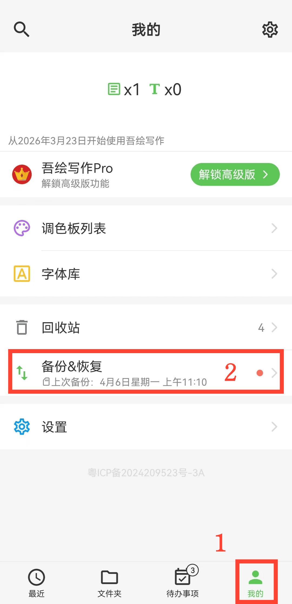

[Manuale utente](/yeswriter/manual/it) >

Backup e ripristino
---

Con backup e ripristino puoi proteggere le informazioni importanti ed evitare perdite accidentali di dati.

- [Eseguire backup dati](data_backup.md)

- [Backup automatico](automatic_backup.md)

- [Ripristinare dati](data_recovery.md)

- [Gestire file di backup](manage_backup_data.md)

- [Backup nel cloud con Jianguoyun](jianguoyun_backup.md)

