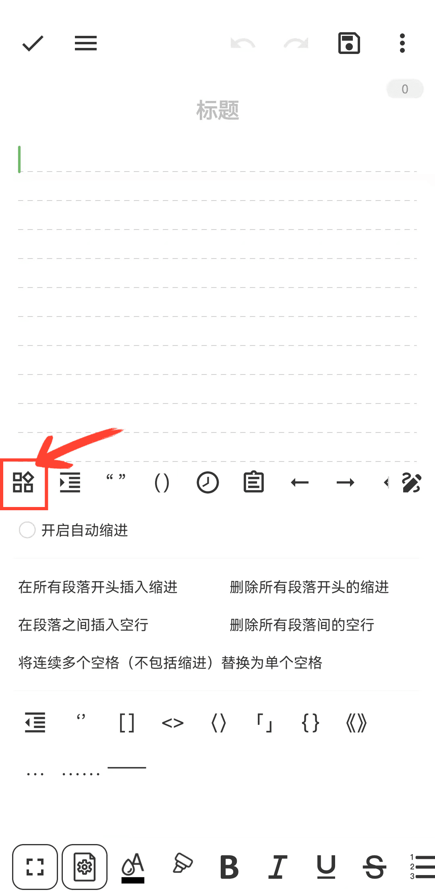

[Manuale utente](/yeswriter/manual/it) > [Modifica testo](/yeswriter/manual/it/notes_page) >

Usare la barra rapida
---
Nella barra rapida puoi inserire rapidamente parentesi, virgolette, timestamp o aprire gli appunti.

#### Suggerimenti

1. Tocca “Input rapido” per regolare rapidamente la formattazione dei paragrafi.

2. Tocca il pulsante “⋮” in alto a destra per mostrare o nascondere la barra rapida.

