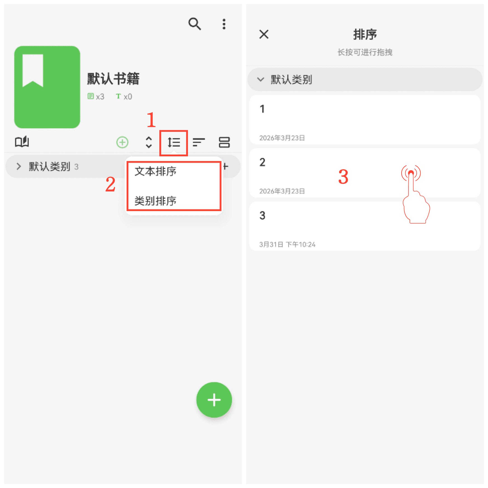

[ユーザーマニュアル](/yeswriter/manual/ja) > [ブック管理](/yeswriter/manual/ja/book_page) >

テキストとカテゴリの並び順を調整
---
#### 操作手順

「並び順」ボタンをタップし、必要な並び順を選択します。

手動で順序を調整
---
#### 操作手順

1. 「手動並び替え」を選択した後、隣の「手動並び替え」ボタンをタップします。

2. テキストの並び替え、またはカテゴリの並び替えを選択します。

3. 項目を長押しして上下にドラッグし、順序を調整します。

