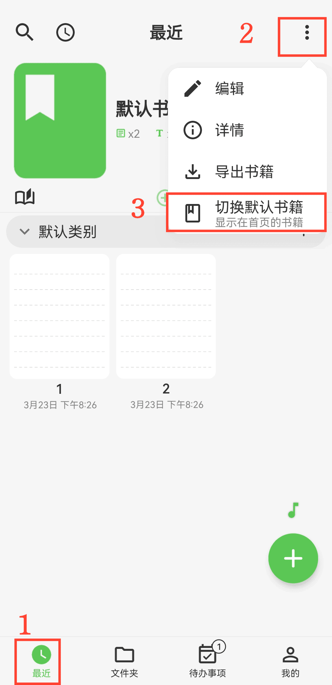

[ユーザーマニュアル](/yeswriter/manual/ja) > [ブック管理](/yeswriter/manual/ja/book_page) >

デフォルトブックを設定
---
#### 操作手順

1. 「最近」ページに入ります。

2. 「その他」ボタンをタップします。

3. 「デフォルトの本を切り替える」を選択します。

#### ヒント

デフォルトブックを設定すると、YesWriter を開いたときに必要なブックへ直接入れます。
