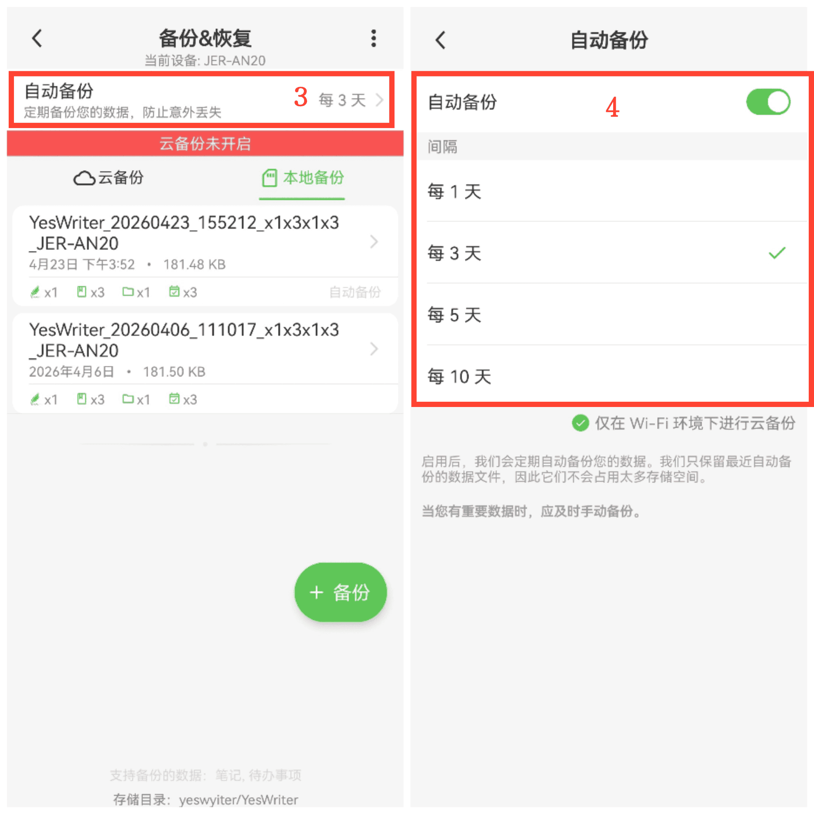

[ユーザーマニュアル](/yeswriter/manual/ja) > [バックアップ & リストア](/yeswriter/manual/ja/data_backup_and_recovery) >

自動バックアップ
---
#### 操作手順

1. メインページで「私」をタップします。

2. 「バックアップ & リストア」に入ります。

3. 「自動バックアップ」をタップします。

4. 「自動バックアップ」をオンにし、バックアップ間隔を選択します。

