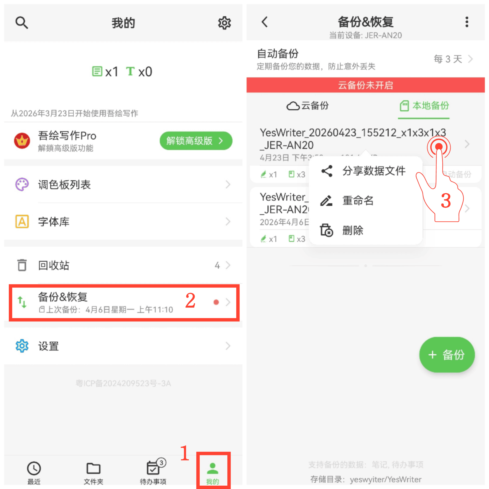

[ユーザーマニュアル](/yeswriter/manual/ja) > [バックアップ & リストア](/yeswriter/manual/ja/data_backup_and_recovery) >

バックアップファイルを管理
---
#### 操作手順

1. メインページで「私」をタップします。

2. 「バックアップ & リストア」に入ります。

3. バックアップファイルを長押しすると、バックアップデータの共有、名前変更、削除ができます。

