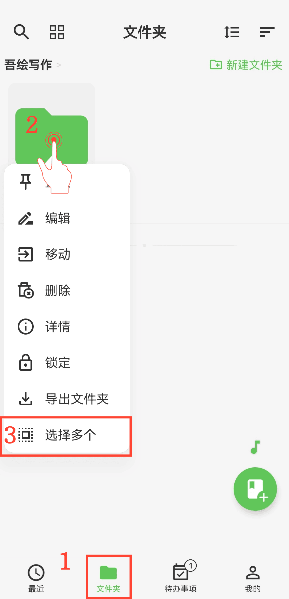

[ユーザーマニュアル](/yeswriter/manual/ja) > [フォルダ管理](/yeswriter/manual/ja/folder) >

フォルダを一括管理
---

#### 操作手順

1. 「フォルダ」ページに入ります。

2. 対象フォルダを長押しします。

3. ポップアップメニューで「複数選択」をタップします。

4. 対象フォルダにチェックを入れ、一括で移動、削除、またはエクスポートします。

