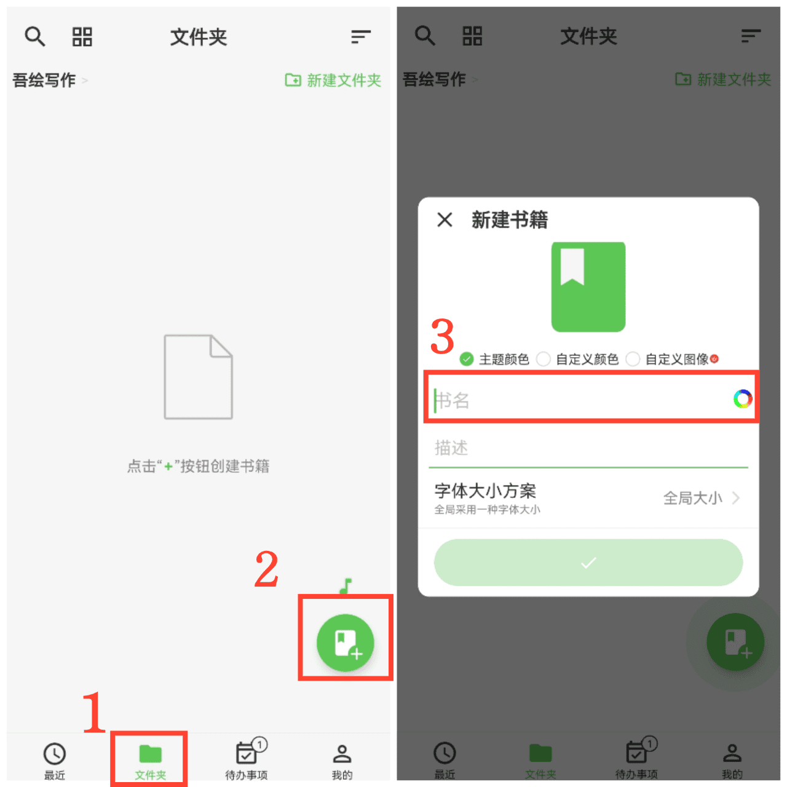

[ユーザーマニュアル](/yeswriter/manual/ja) > [コンテンツを作成](/yeswriter/manual/ja/new) >

ブックを作成
---

#### 操作手順

1. 「フォルダ」ページに入ります。
2. 「+」をタップします。
3. ブック名を入力します。

#### ヒント

1. 「フォルダ」ページで作成したブックは、そのページに表示されます。フォルダ内に入ってから作成したブックは、該当フォルダ内に表示されます。

2. 「カスタム画像」をタップすると、アルバムから画像を選んでブックカバーにできます。

3. ブック名右側のカラーボタンをタップすると、ブック名の色を設定できます。

4. 「説明」をタップすると、ブックの説明を追加できます。

5. 「フォントサイズ設定」をタップすると、全体で統一したフォントサイズ、または個別のフォントサイズを設定できます。
