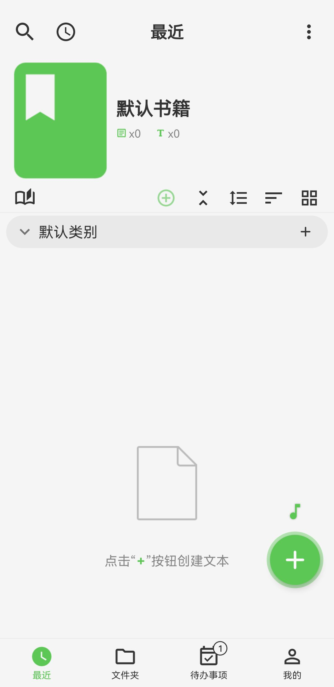

[ユーザーマニュアル](/yeswriter/manual/ja) > [コンテンツを作成](/yeswriter/manual/ja/new) >

新しいテキスト
---
#### 操作手順

「最近」ページに入り、右下の緑色の「+」ボタンをタップすると、新しいテキストを作成できます。

#### ヒント

「最近」ページで作成したテキストは、デフォルトでリスト下部の「カテゴリ」に追加されます。指定したカテゴリにテキストを追加したい場合は、該当カテゴリ右側の「+」ボタンをタップして作成してください。

