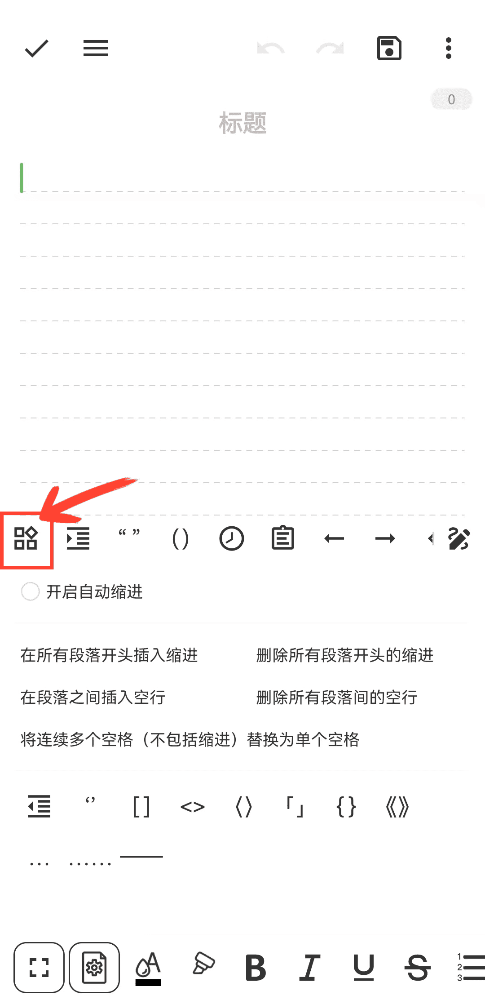

[ユーザーマニュアル](/yeswriter/manual/ja) > [テキスト編集](/yeswriter/manual/ja/notes_page) >

クイックツールバーを使う
---
クイックツールバーでは、括弧、引用符、タイムスタンプをすばやく挿入したり、クリップボードを開いたりできます。

#### ヒント

1. 「クイック入力」ボタンをタップすると、段落レイアウトをすばやく設定できます。

2. 右上の「⋮」ボタンをタップすると、クイックツールバーの表示/非表示を切り替えられます。

