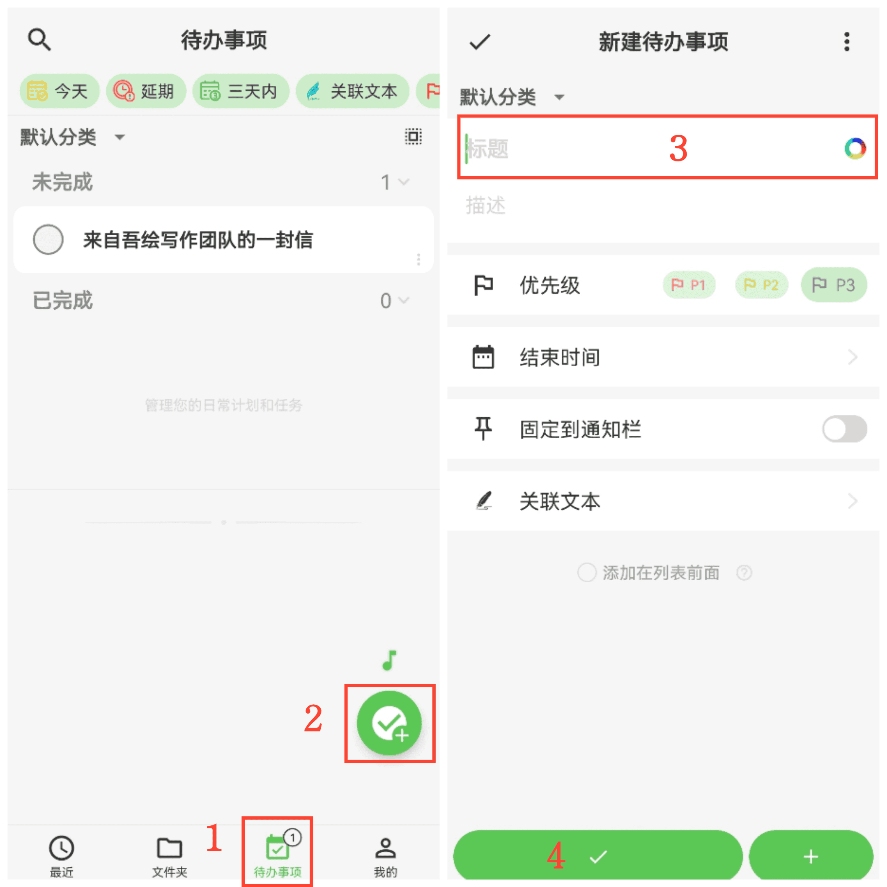
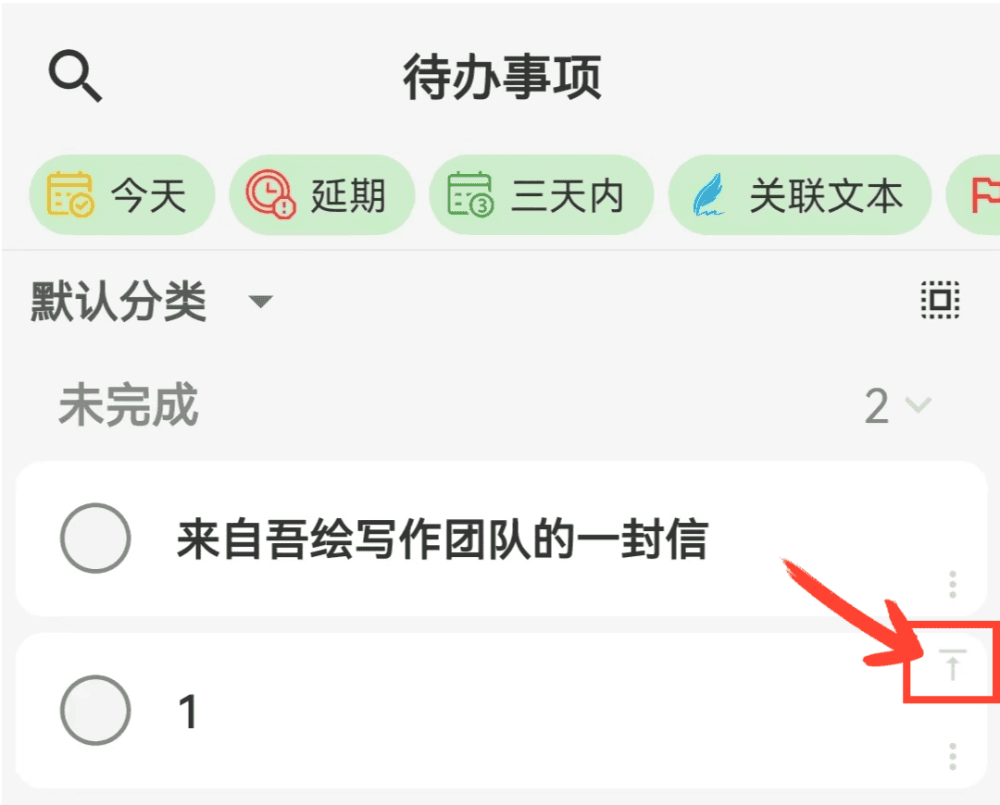

[ユーザーマニュアル](/yeswriter/manual/ja) > [To-do](/yeswriter/manual/ja/to_do) >

To-do を作成
---
#### 操作手順

1. 「To-do」ページに入ります。

2. 右下の「+」ボタンをタップします。

3. タイトル、説明などの情報を入力します。

4. 「確認」をタップして作成を完了します。

#### ヒント

1. 連続追加：「新しい To-do」ページで左下の「+」をタップすると、ページを閉じずに続けて追加できます。

2. 件数表示：下部タブバーには、現在未完了の To-do 数が表示されます。

3. 固定表示：リスト内で項目右上の「固定」をタップすると、その項目を上部へ移動できます。

