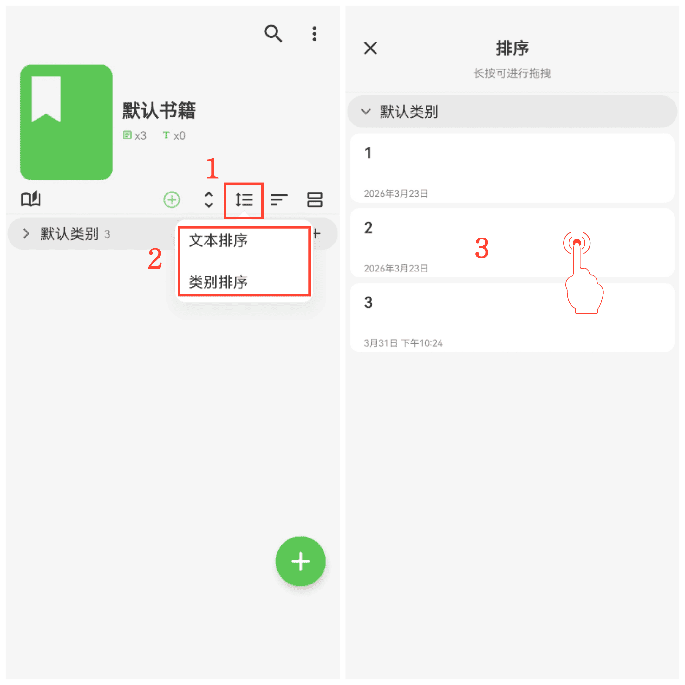

[Manual do usuário](/yeswriter/manual/pt) > [Gerenciamento de livros](/yeswriter/manual/pt/book_page) >

Ordenar textos e categorias
---
#### Etapas

Toque em “Ordenar por” e selecione o método de ordenação desejado.

Ordenação manual
---
#### Etapas

1. Depois de selecionar “Ordenação manual”, toque no botão “Ordenação manual” ao lado.

2. Escolha ordenação de textos ou de categorias.

3. Mantenha um item pressionado e arraste-o para cima ou para baixo para ajustar a ordem.

