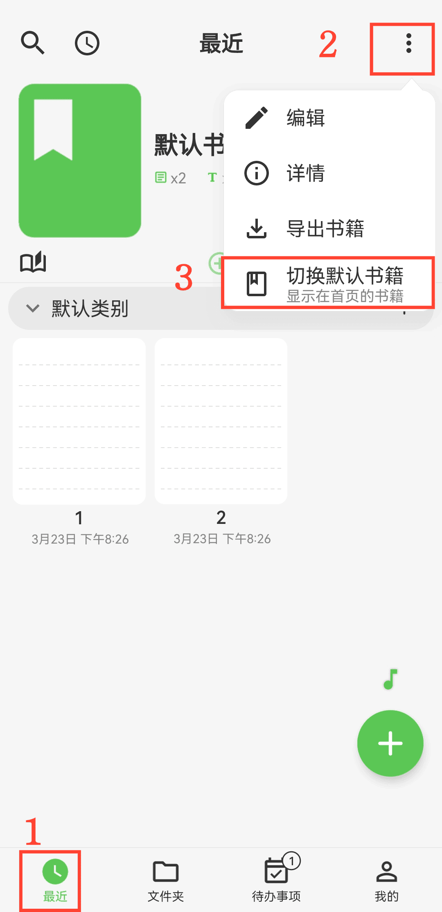

[Manual do usuário](/yeswriter/manual/pt) > [Gerenciamento de livros](/yeswriter/manual/pt/book_page) >

Definir livro padrão
---
#### Etapas

1. Acesse a página “Mais recentes”.

2. Toque em “Mais”.

3. Selecione “Alterar livro padrão”.

#### Dicas

Depois de definir um livro padrão, o YesWriter pode abrir diretamente o livro desejado.
