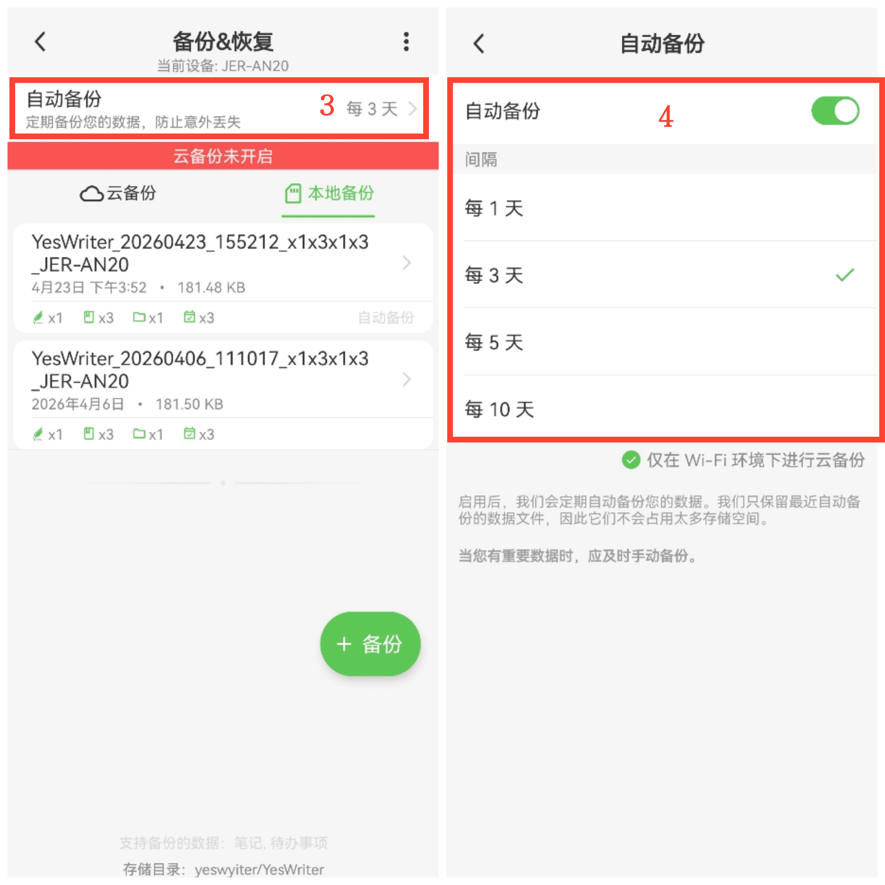

[Manual do usuário](/yeswriter/manual/pt) > [Backup e restauração](/yeswriter/manual/pt/data_backup_and_recovery) >

Backup automático
---
#### Etapas

1. Acesse a página “Eu”.

2. Toque em “Backup e restauração”.

3. Toque em “Backup automático”.

4. Ative o backup automático e selecione um intervalo de backup.

