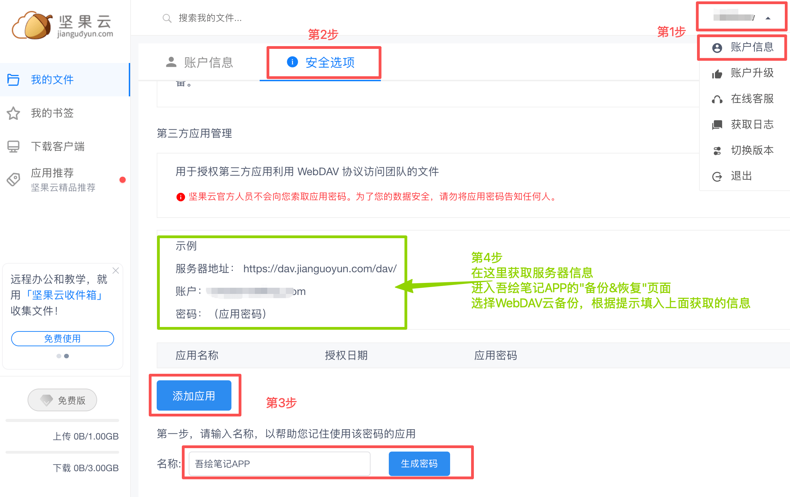

[Manual do usuário](/yeswriter/manual/pt) > [Backup e restauração](/yeswriter/manual/pt/data_backup_and_recovery) >

Fazer backup na nuvem com Jianguoyun
---
O Jianguoyun oferece armazenamento gratuito na nuvem. Você pode fazer backup dos dados no Jianguoyun de forma segura e prática, para restaurar rapidamente todos os textos mesmo após trocar de dispositivo ou reinstalar o app.

### Etapas

Abra o site do Jianguoyun e registre-se ou entre pela versão web.

(Se abrir o Jianguoyun no telefone, escolha “Entrar na versão web”. Se não tiver uma conta, crie uma primeiro. Depois de entrar, mude para a aba “Eu” na parte inferior e toque em “Solicitar site para desktop” para abrir a página desktop.)

1. Depois de entrar, clique no seu nome de usuário no canto superior direito e escolha “Informações da conta”.
2. Mude para a aba “Opções de segurança” na parte superior.
3. Role até “Gerenciamento de apps de terceiros”, clique em “Adicionar app”, insira um nome como YesWriter e clique em “Gerar senha”.
4. De acordo com as informações exibidas na página, acesse YesWriter -> Backup e restauração -> Backup na nuvem, selecione WebDAV e preencha:
    * **Endereço do servidor e nome da conta: preencha conforme indicado na página web.**
    * **Senha: use a senha de app recém-gerada, que pode ser vista na lista de apps do Jianguoyun.**

Depois da configuração, você pode sincronizar textos com o Jianguoyun. Ao trocar de dispositivo ou reinstalar o app, entre no Jianguoyun para restaurar rapidamente todos os textos.

