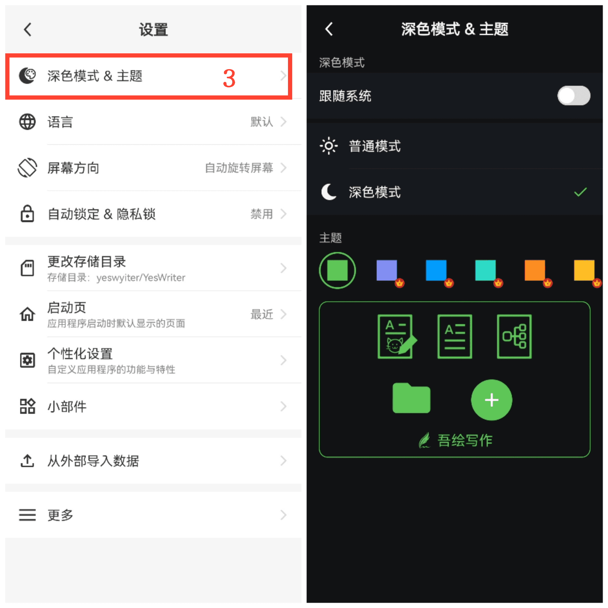

[Manual do usuário](/yeswriter/manual/pt) > [Configurações](/yeswriter/manual/pt/settings) >

Alternar modo escuro e cor do tema
---
O modo escuro oferece uma experiência de leitura mais confortável e ajuda a reduzir o cansaço visual. Esse recurso permite alternar para o modo escuro e escolher uma cor de tema conforme sua preferência.

### Etapas
1. Na tela principal, toque em “Eu”.
2. Acesse Configurações.
3. Toque em “Modo escuro e tema”.
4. Aqui você pode alternar o modo escuro e escolher diferentes cores de tema para personalizar a interface.

