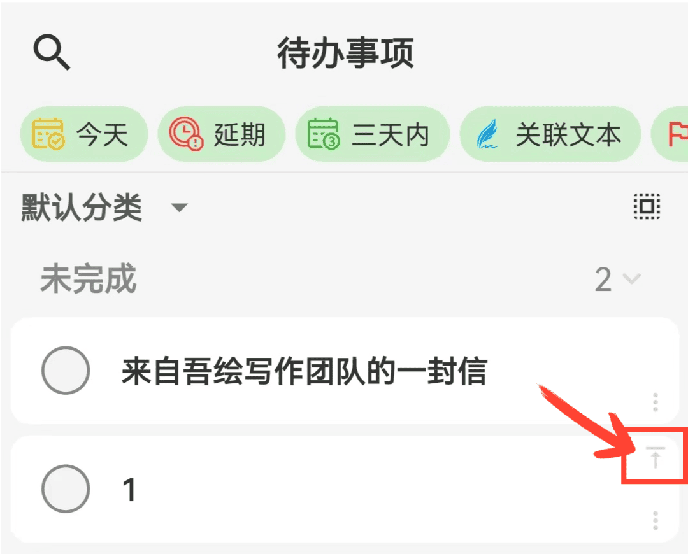

[Manual do usuário](/yeswriter/manual/pt) > [Tarefas](/yeswriter/manual/pt/to_do) >

Criar tarefa
---
#### Etapas

1. Acesse a página “Tarefas”.

2. Toque no botão “+” no canto inferior direito.

3. Preencha o título, a descrição e outras informações.

4. Toque em “Confirmar” para criá-la.

#### Dicas

1. Adição contínua: na página “Nova tarefa”, toque em “+” no canto inferior esquerdo para continuar adicionando sem sair da página.

2. Contagem de itens: a barra inferior mostra o número de tarefas ainda não concluídas.

3. Fixar item: toque em “Fixar” no canto superior direito de um item da lista para movê-lo para o topo.

