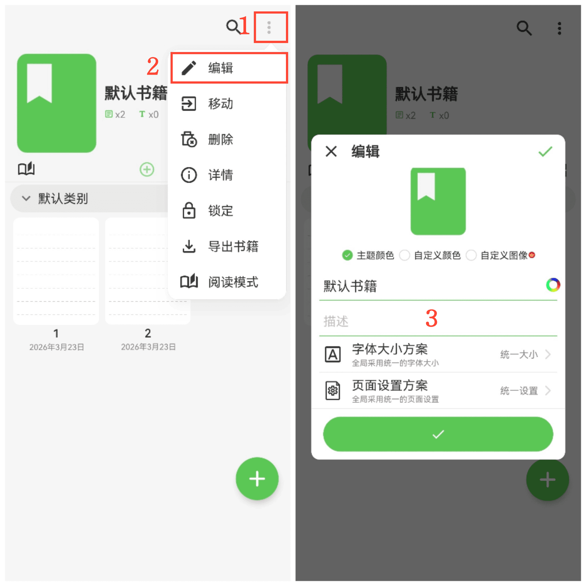

[使用手冊](/yeswriter/manual/zh-tw) > [書籍管理](/yeswriter/manual/zh-tw/book_page) >

修改書籍封面和字型
---
#### 操作步驟

1. 點選右上角「更多」。

2. 點選「編輯」，進入書籍編輯頁面。

#### 提示

1. 點選「自訂圖像」，可從相簿選擇圖片作為書籍封面。

2. 點選書名右側的彩色圓形按鈕，可設定書名顏色。

3. 點選「描述」，可為書籍新增簡介。

4. 點選「字型大小方案」，可設定全域統一字型大小或自訂局部字型大小。

5. 點選「頁面方案」，可設定全域統一背景或自訂獨立背景。
