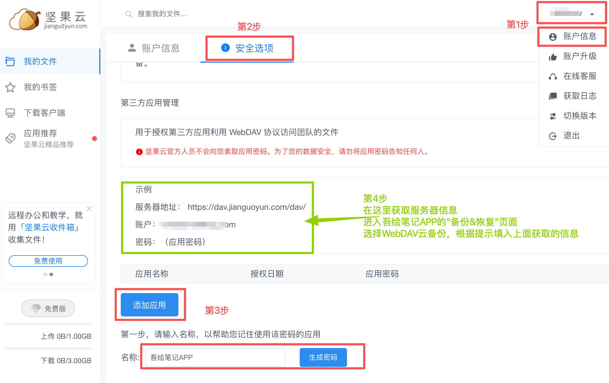

[使用手冊](/yeswriter/manual/zh-tw) > [備份與還原](/yeswriter/manual/zh-tw/data_backup_and_recovery) >

使用堅果雲備份到雲端
---
堅果雲提供免費的雲端空間，您可以將資料備份到堅果雲，實現安全、便捷的雲端備份。這樣即使更換裝置或重新安裝應用，也能快速還原所有文本。

### 操作步驟

開啟堅果雲官網，使用網頁版註冊並登入帳號。

(如果是手機開啟堅果雲官網，則選擇「登入網頁版」，沒有帳號的話先「建立帳號」，登入後切換底部標籤至「我的」，點選「請求桌面網站」，進入桌面版網頁。)

1. 登入後點選頁面右上角的使用者名稱，選擇「帳戶資訊」。
2. 在頂部切換至「安全選項」標籤頁。
3. 滑動至底部的「第三方應用管理」區域，點選「新增應用」，輸入名稱（例如 吾繪寫作），然後點選「產生密碼」。
4. 根據頁面顯示的資訊，在「吾繪寫作 → 備份&恢復 → 雲備份」頁面中，選擇「WebDAV」填寫相應內容：
    * **伺服器位址、帳戶名：按網頁提示填寫。**
    * **密碼：使用剛剛產生的應用密碼（可在堅果雲的應用列表中查看）。**

完成後，即可將文本同步備份到堅果雲。更換裝置或重新安裝應用時，只需登入堅果雲即可快速還原所有文本。

