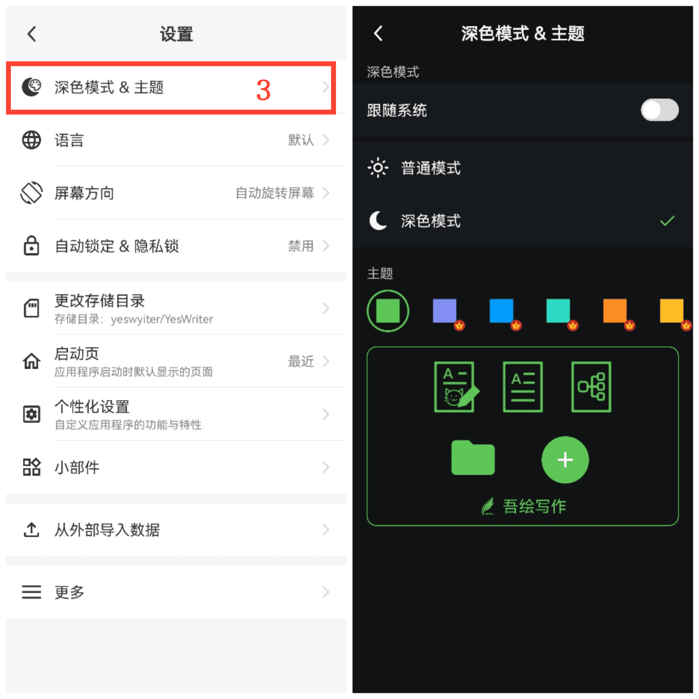

[使用手冊](/yeswriter/manual/zh-tw) > [設定](/yeswriter/manual/zh-tw/settings) >

切換深色模式與主題色
---
深色模式提供更加舒適的閱讀體驗，有助於減少眼睛疲勞並保護視力健康。這一功能使您能夠輕鬆切換到更舒適的深色模式，並根據個人喜好選擇主題顏色。

### 操作步驟
1. 在主螢幕上點選「我的」。
2. 進入設定。
3. 點選「深色模式&主題」。
4. 在此處，您可以切換深色模式並選擇不同的主題顏色以自訂個人化介面。

