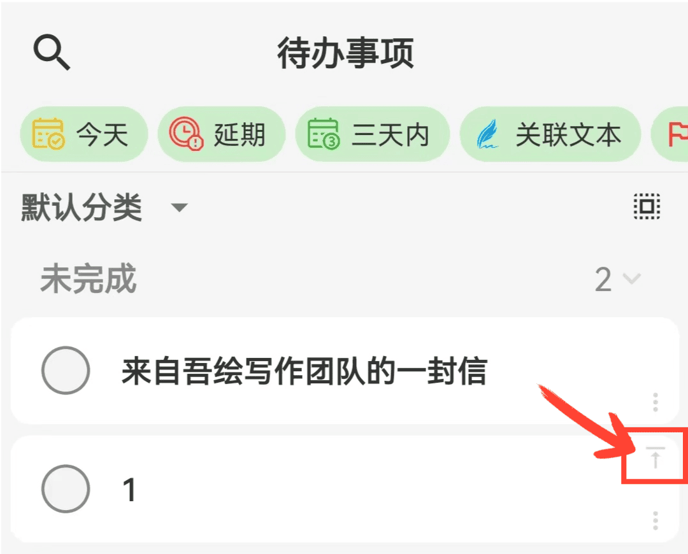

[使用手冊](/yeswriter/manual/zh-tw) > [待辦事項](/yeswriter/manual/zh-tw/to_do) >

建立待辦事項
---
#### 操作步驟

1. 進入「待辦事項」頁面。

2. 點選右下角「+」按鈕。

3. 填寫標題、描述等資訊。

4. 點選「確認」，完成建立。

#### 提示

1. 連續新增：在「新建待辦事項」頁面點選左下角「+」，無需退出即可繼續新增。

2. 事項計數：底部標籤列顯示目前待完成事項數量。

3. 置頂事項：在列表中點選事項右上角「置頂」，將其移動至頂部。

